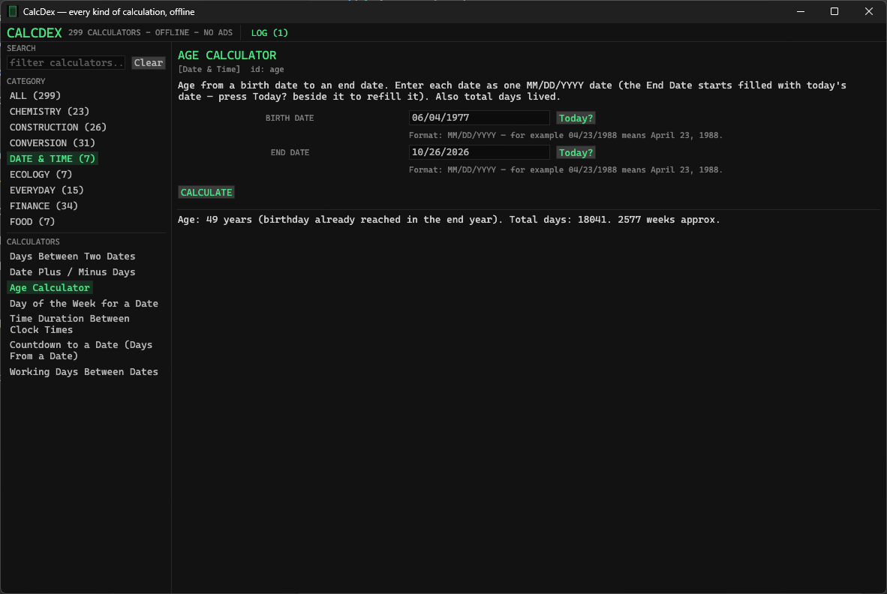
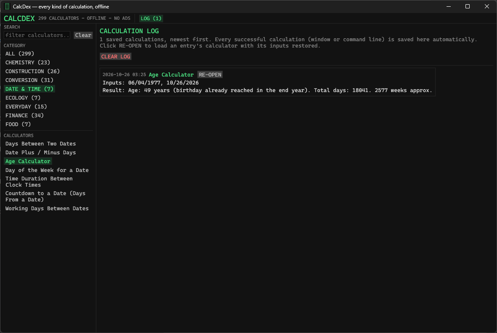

# CalcDex

## TL;DR

CalcDex is one free program for Windows that does almost every kind of
calculation in one place — like having a big box of hundreds of different
calculators (for money, health, school maths, building jobs, cooking,
sports, and much more) that all work with no internet, no ads, and no
sign-up. Pick a calculator, type your numbers, read the answer with the
working shown in plain words. It also works from the command line for
people who like typing commands.

Free forever. Optional donations are allowed but never required and
never unlock anything. No ads, no in-app purchases, no selling data.

## Who it is for

CalcDex is built for **students, teachers, professors, scientists
and engineers** — people who need a result they can check, not just a
number. That is why every calculator:

- shows its **formula, the substituted values, and the result**
  (worked steps you can follow or mark against),
- keeps **full precision** in results (rounded forms are labelled,
  never silently substituted),
- accepts **scientific notation** inputs (e.g. `6.022e23`, `1.5e-3`),
- names the **constants** it uses (g = 9.80665 m/s², R = 0.082057
  L·atm/(mol·K) = 8.314 J/(mol·K), Avogadro 6.02214076×10²³),
- uses correct **units and symbols**, and labels anything that is an
  approximation as an **ESTIMATE** (body-fat, BAC, race prediction,
  carbon footprint and similar),
- explains input errors in words that say *why* there is no answer
  (for example: log of a negative number has no real value).

**For students & teachers:** results read like worked solutions —
formula first, then the numbers put in, then the answer — so homework
and lab calculations can be verified line by line.

**For professionals:** the same registry runs from the command line,
so any calculation in the window can be scripted, repeated and logged
with identical output.

## What it does

CalcDex brings together the calculator sets of two big websites —
Omni Calculator (3,938 calculators) and Nutilz (637+ tools, calculator
subset only) — as one offline desktop program. Where those sites list
hundreds of near-identical pages (for example a separate page for every
unit pair), CalcDex uses one calculator where you pick the units —
see `docs/COVERAGE.md` for the honest mapping.

Categories: Math, Finance, Health, Physics, Chemistry, Construction,
Conversion, Statistics, Date & Time, Everyday, Sports, Food, Ecology,
Other.

Every calculator shows its formula and the steps in plain words, and
handles bad input (dividing by zero, square root of a negative, and so
on) with a clear message instead of crashing.

## The look

Dark "Terminal" theme, exactly SEAN's Purgeon Terminal colours:
near-black background `#0c0c0c`, panels `#121212`, phosphor-green
accent `#4ade80`, Cascadia Mono type, sharp corners everywhere.


## How to use it (window)

Since v0.2.0 the window uses the **Design 3** layout SEAN picked
from the eight research mockups (mode rail / centre work area /
history rail — the pattern Microsoft's Calculator app uses):

1. Run `CalcDex.exe`.
2. **Mode rail (far left):** the categories are *modes* — ALL,
   MATH, FINANCE, HEALTH, and so on. Click a mode to see its
   calculators, or hold **Alt** and press the key printed on the
   mode's row. The full working shortcut set is Alt+1 … Alt+9,
   Alt+0 for the first ten modes, then Alt+Q, Alt+W, Alt+E,
   Alt+R, Alt+T for the last five, in rail order. The **Search**
   box at the top of the rail filters every calculator by name.
3. **Centre:** click a calculator in the chip strip under the mode
   heading, then fill in the labelled boxes (list calculators take
   numbers separated by commas or spaces in one big box). Dates go
   in ONE box per date, in the format the hint under the box
   shows — MM/DD/YYYY, so 04/23/1988 means April 23, 1988. Press
   the green **Today?** button beside any date box to fill in
   today's date (the Age calculator's End Date and the Countdown's
   From Date already start filled with today).
4. **Keypad:** the big on-screen keypad types into the last box
   you clicked — digits, decimal point, +/-, DEL and C, a `/` key
   for date boxes (a `,` key for list boxes); keys that make no
   sense for the box are greyed out. A whole calculation can be
   run with the mouse alone, which suits a teacher projecting the
   app. Your keyboard works everywhere too.
5. Press **CALCULATE** (or the keypad's **=**, or Enter). The
   result appears in the **Display** at the top of the centre in
   large green type, with the full formula and worked steps in the
   footer block underneath — nothing is cut down to one line.
6. **History rail (right):** every result is saved there at once
   (see Calculation log below). RE-OPEN on an entry restores its
   calculator and inputs. On a narrow window the rail collapses —
   below 1100 points wide the header **LOG** button shows the same
   history in the centre instead.

## How to use it (command line)

Every calculator works the same from the command line — nothing is
window-only:

```
CalcDex --list
CalcDex --search loan
CalcDex compound-interest 1000 5 10
CalcDex bmi 70 175
CalcDex mean 1 2 3 4
CalcDex convert-length 1 7 3
CalcDex age 04/23/1988 10/25/2026
```

Dates on the command line are one argument in MM/DD/YYYY form, just
like the window (the old six-number form `1988 4 23 2026 10 25`
still works and gives the identical answer).

Numbers go in the same order as the labelled boxes in the window.
For unit converters the two extra numbers pick the units from the
numbered list shown in that calculator's description.
`CalcDex --help` explains the rest.

## Calculation log

Every successful calculation is saved automatically — whether you
ran it in the window or on the command line — so classwork, lab
results and estimates (SEAN's original request was for age
calculations) can be found again later:

- The saved entries live in the **History rail** docked on the
  right of the window, newest first (header **LOG** shows/hides
  it; on narrow windows the same history opens in the centre).
  **RE-OPEN** on an entry loads that calculator with its inputs
  restored; **CLEAR LOG** empties the log.
- Or from the command line: `CalcDex --log` prints the log and
  `CalcDex --clear-log` empties it.
- Entries are kept in `%APPDATA%\CalcDex\history.txt` (plain text:
  time, calculator, inputs — dates in MM/DD/YYYY form — and result).
  Only the newest 500 entries are kept; log timestamps are UTC.
  Failed calculations are never logged.

## Requirements & building

- Windows 10/11 for the shipped program (it is a standard Windows
  .exe; it also builds and runs on Linux for development).
- To build from source: a recent Rust toolchain, then:
  `cargo build --release` — and the full check is
  `cargo fmt + cargo clippy --all-targets + cargo test --locked`.

## Install

Releases carry exactly two files, as always:

1. `CalcDex-Setup-0.2.0.exe` — the installer (per-user, no admin).
2. `CalcDex-0.2.0-portable.zip` — the portable build: just the .exe
   plus the license and a short note. Unzip and run.

The program is unsigned (no code-signing certificate) — Windows may
warn on first run; choose "More info", then "Run anyway", if you trust
this build. Check the SHA-256 in the release notes to be sure.

## Screenshots

Real captures from SEAN's machine, taken during the v0.1.1 field
test (2026-10-25). They show the OLD left column — v0.1.2 makes the
lists brighter, larger, and single-line; a fresh main-window capture
after the readability fix is still needed.



*Age Calculator (v0.1.1 capture): one MM/DD/YYYY box per date, the
format hint under each field, and a Today? button beside each date.
The result shown — 06/04/1977 to 10/26/2026 = 49 years / 18,041
days / 2,577 weeks — was independently re-checked and is exactly
right.*



*Calculation Log (v0.1.1 capture): every calculation is saved
automatically; RE-OPEN restores an entry's calculator and inputs,
CLEAR LOG empties the log. Timestamps are UTC.*

**Captures still needed (real ones only, no placeholders):** a fresh
main-window shot of **v0.2.0** showing the Design 3 layout (mode
rail, keypad, display, history rail), ideally one at full width and
one narrow enough that the history rail has collapsed.

## Limitations (honest)

- Formula calculators only: the very specialised Omni pages that need
  live data (currency exchange rates, weather, stock prices), big
  lookup tables (tax brackets by country/year), medical diagnosis, or
  drawing graphs are not in v0.1 — they are listed in
  `docs/ROADMAP.md`, not silently dropped.
- Health and building results are estimates from the standard
  published formulas named in each calculator. They are not medical
  or engineering advice.
- See `docs/PARITY.md` for category-by-category scoring from test
  evidence.

## License

MIT — see `LICENSE`. Free software; use it, share it, change it.
